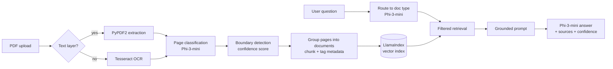

# Pharma Document Q&A: Open-Source RAG Pipeline

Ask questions about pharmaceutical supplier documentation and get grounded answers with cited sources and a confidence score. The whole pipeline runs on open-source models in a single Colab notebook, with no paid API calls.

Supplier documentation packages often arrive as one long PDF that combines several unrelated documents: a cover letter, quality certificates, specifications, regulatory statements, and sterilization records. Some of these are scans. This project splits a package like that into its individual documents, indexes them, and answers questions using only what the documents actually say.

> **Sample data:** every company, product, person, and number in `sample_docs/` is fictional, generated by `sample_docs/generate_samples.py`.

## What it does

- **OCR-aware extraction.** Text is pulled directly from digital pages. Pages with little or no text layer are routed through Tesseract OCR.
- **Document classification and boundary detection.** Phi-3-mini labels each page with a document type and decides whether it continues the previous document or starts a new one. The boundary decision uses the model's yes/no token probabilities as a confidence score.
- **Metadata-tagged chunking.** Pages are grouped into logical documents, then chunked. Each chunk carries its `doc_id`, `doc_type`, page range, and source file.
- **Query routing.** Before retrieval, the model predicts which document type is most likely to hold the answer, and retrieval is filtered to that type.
- **Grounded generation with citations.** The answer prompt contains only the retrieved chunks. The model must cite them and say so when the answer isn't there.
- **Gradio UI.** Upload one or more PDFs, watch processing status, choose a response mode, and see the sources behind each answer.

## Architecture



## Tech stack

| Layer | Tools |
|---|---|
| Language model | `microsoft/Phi-3-mini-4k-instruct` (Hugging Face Transformers) |
| Embeddings | Hugging Face sentence-transformers via `llama-index-embeddings-huggingface` |
| Vector index and retrieval | LlamaIndex `VectorStoreIndex` with metadata filters |
| PDF and OCR | PyPDF2, pdf2image, pytesseract (Tesseract) |
| Chunking | LangChain `RecursiveCharacterTextSplitter` |
| UI | Gradio |
| Runtime | Google Colab, T4 GPU |

## Running it

1. Open `pharma_doc_qa_rag.ipynb` in Google Colab.
2. Go to **Runtime → Change runtime type** and select a **T4 GPU**.
3. Upload `sample_docs/supplier-package-a.pdf` and `sample_docs/supplier-package-b.pdf` to `/content/` using the Files panel.
4. Run all cells in order. The first run downloads the models, which takes a few minutes.
5. The Gradio cell prints a public `gradio.live` link. Open it to use the chatbot.

The evaluation cells at the end reprocess one sample PDF from scratch and score it against its test set. To switch between the two, set `ACTIVE_SAMPLE = "A"` or `"B"` in the reprocess cell.

## Sample data

| File | Format | Pages | Documents | What it tests |
|---|---|---|---|---|
| `supplier-package-a.pdf` | Digital | 9 | 7 | Mixed document types; multi-page documents (pages 1–2, 6–7) |
| `supplier-package-b.pdf` | Scanned (images only) | 7 | 6 | OCR path; two back-to-back documents of the same type (pages 1 and 2) |

To regenerate the PDFs, run:

```bash
pip install reportlab pdf2image pillow   # pdf2image also needs poppler
python sample_docs/generate_samples.py
```

## Evaluation

Each sample has a 10-question test set that specifies the expected answer and the document and pages that should be retrieved.

- **Recall@K:** the share of questions where at least one retrieved chunk comes from the correct document and pages.
- **Precision@K:** the share of retrieved chunks that are relevant, averaged across questions.
- **MRR:** mean reciprocal rank of the first relevant chunk.
- **End-to-end and citation accuracy:** graded manually in the notebook. Each answer and its citation are marked correct or incorrect.
- **Latency:** routing, retrieval, and generation are timed separately.

An answer counts as correct only if it is complete. A citation counts as accurate if the cited chunk comes from the correct document and pages.

| Sample | Recall@K | Precision@K | MRR | Answer accuracy | Citation accuracy | Document classification |
|---|---|---|---|---|---|---|
| A (digital) | 80% | 65% | 0.80 | 60% (6/10) | 80% (8/10) | 6 of 7 correct |
| B (scanned) | 80% | 70% | 0.75 | 80% (8/10) | 80% (8/10) | 6 of 6 correct |

Average latency per question on a Colab T4:

| Sample | Routing | Retrieval | Generation (avg) | Generation (max) |
|---|---|---|---|---|
| A | 1.66 s | 0.03 s | 2.87 s | 6.91 s |
| B | 1.16 s | 0.02 s | 1.24 s | 1.73 s |

### What the results show

- **Query routing caused every retrieval miss.** Across both samples, 4 of 20 questions never retrieved the right document, and in all 4 the classifier had labeled that document correctly. The router sent the question to the wrong document type. In sample A, two questions about the Vendor Qualification Record went to Certificate of Quality and Compliance Bulletin. In sample B, two questions about what packaging is made of went to the Material Description Sheet, a reasonable confusion since that document is all about materials. Retrieval is filtered by the routed type, so the right document was never searched.
- **Grounding held up when retrieval failed.** For all 4 misrouted questions, the model answered "I cannot find this information in the provided documents" instead of inventing an answer.
- **Classification and boundary detection were strong, even on scans.** 12 of 13 documents were labeled correctly. In sample B, two Certificates of Quality on back-to-back pages were correctly split into separate documents, and every question whose document was retrieved from the scanned PDF was answered correctly.
- **Retrieval is cheap, and the LLM is not.** Retrieval takes 20–30 ms. Routing and generation are both LLM calls, and they account for nearly all of the response time. Generation in sample A took more than twice as long on average, likely because several of its answers were longer lists.

## Known limitations

- **Classification can vary between runs.** A small model doesn't always label the same page the same way. Majority-vote classification and confidence-based boundary decisions reduce the variation without removing it.
- **Processing is slow.** Every page passes through the LLM during indexing, so a long PDF takes several minutes on a T4.
- **Built for Colab.** The notebook depends on Colab's `/content/` paths and GPU runtime, and isn't packaged to run locally.
- **A wrong routing decision can't be recovered.** Retrieval only searches the routed document type, so a misrouted question misses its document even when that document is correctly indexed. This was the cause of every retrieval miss in testing. Possible fixes include falling back to unfiltered retrieval when confidence is low, or searching the top two predicted types.
- **Short, summary-style pages can be mislabeled.** The cover letter, which lists the other documents in the package, was classified as a Certificate of Quality. Boundary detection still kept it as a separate document, and the answer cited the correct page. But because retrieval is filtered by type, a mislabeled page can be skipped when the router picks the correct type.
- **Tables lose their column structure.** Text extraction flattens table rows, so the model can confuse columns. In one test, it reported a specification limit (< 10 CFU/stopper) instead of the measured result (2 CFU/stopper).
- **List answers can be incomplete.** Asked for the three primary packaging components, the model returned two.
- **Questions spanning documents are harder.** Query routing narrows retrieval to one document type, so a question that needs information from two different document types may miss part of the answer.

## Author

**Angela Allegra Hutchison**
